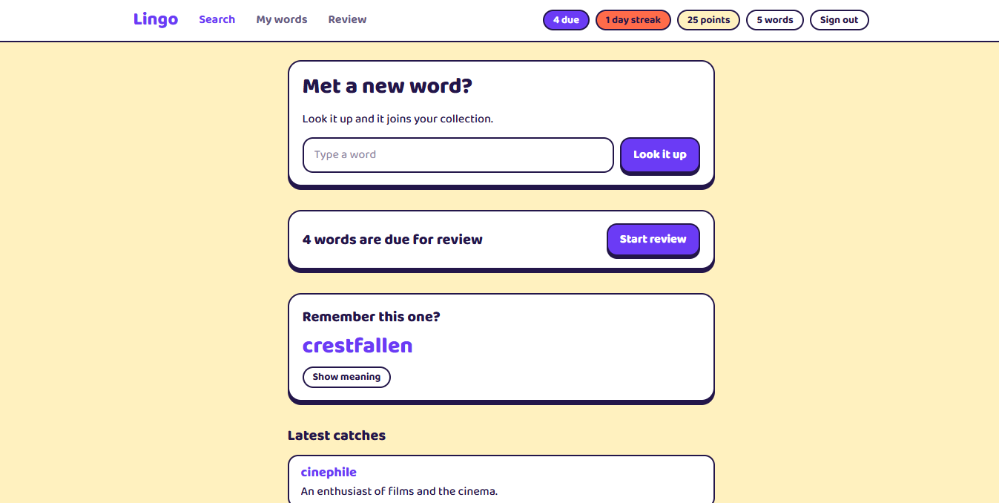
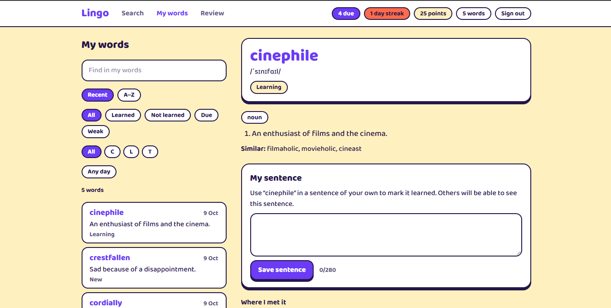

# Lingo

A vocabulary app for the words you meet while reading. Look a word up and it is saved with its meaning, pronunciation and examples. Write a sentence with each word to mark it learned, and review your words on a spaced schedule.

Built with Next.js 16, Supabase and Tailwind 4. Everything runs on free tiers.





## Features

- **Look up and save:** one search box; a word that is not found gets "did you mean" suggestions.
- **Word page:** meanings, examples and similar words, plus your own note and where you met the word.
- **My words:** sort by recent or A–Z, and filter by text, first letter, the day added, or state (learned, not learned, due, weak).
- **Sentences:** one sentence of your own per word marks it learned.
- **Review:** flashcards for the words that are due, up to twenty a round.
- **Progress:** streak, points and word count in the header, a mastery level on every word, a word to remember each day, and a grid of the last year's activity.

Days are counted in your browser's time zone.

## Setup

You need Node 22 or newer and a free [Supabase](https://supabase.com) account.

1. Install dependencies:

   ```bash
   npm install
   ```

2. Create a Supabase project. In its SQL editor, run each file in `supabase/migrations` in order. After pulling new code, run any migration you have not run yet before starting the app.

3. Copy the env template and fill in the three keys from **Project Settings > API**:

   ```bash
   cp .env.example .env.local
   ```

4. In **Authentication > URL Configuration**, add `http://localhost:3000/auth/callback` to the redirect URLs.

5. Start the app:

   ```bash
   npm run dev
   ```

Open http://localhost:3000 and sign in with your email.

### Google sign-in (optional)

Supabase's built-in email sender is rate-limited and meant for testing. To let other people sign in, enable the Google provider under **Authentication > Providers**, then set `NEXT_PUBLIC_GOOGLE_SIGN_IN=true`.

## How it works

| Rule | Definition |
|---|---|
| Sentence | One per word, 10 to 280 characters, and it must use the word. The dictionary's forms count ("ran" for "run"), as does a different ending ("laconically" for "laconic") |
| Learned | The word has a sentence |
| Points | 5 for a saved word, 20 for a sentence. Worked out from your words, never stored |
| Streak | Days in a row with a saved word or a new sentence |
| Review | Five boxes that come back after 1, 3, 7, 14 and 30 days. "Got it" moves a word up a box; "Forgot" sends it back to the first |
| Mastery | New until the first review, then learning (boxes 1 and 2), known (3 and 4) or mastered (5) |
| Weak | Forgotten twice or more and still in the first two boxes. Weak words come first in a review |

Sentences can be read by other signed-in users. Words saved before the forms column existed have no forms stored, so irregular forms are not accepted for them.

## Scripts

| Command | What it does |
|---|---|
| `npm run dev` | Start the dev server |
| `npm run build` | Production build |
| `npm run lint` | ESLint |
| `npm run typecheck` | Generate route types, then type-check |
| `npm test` | Unit tests (Vitest) |

## Project layout

| Path | Contents |
|---|---|
| `src/app` | Routes, layouts and Server Actions |
| `src/components` | UI components |
| `src/lib` | Data access (server only) and pure logic with tests |
| `src/proxy.ts` | Refreshes the session and redirects signed-out visitors |
| `supabase/migrations` | Database schema and access rules |

Row-level security in the database is the access boundary: each user can only read and change their own words, and only change their own sentences. The shared `words` table is filled by the server only.

## Deploy

1. Push the repo to GitHub and import it in [Vercel](https://vercel.com).
2. Add the same environment variables in the Vercel project settings.
3. Add `https://<your-domain>/auth/callback` to Supabase's redirect URLs.

Free Supabase projects pause after a week without activity. Restore one from the Supabase dashboard.

## Definitions

Word data comes from [freedictionaryapi.com](https://freedictionaryapi.com) and is cached in the `words` table after the first lookup. It serves [Wiktionary](https://en.wiktionary.org) data under CC BY-SA 4.0 and has no audio.

Spelling suggestions for words that are not found come from [Datamuse](https://www.datamuse.com/api/).
